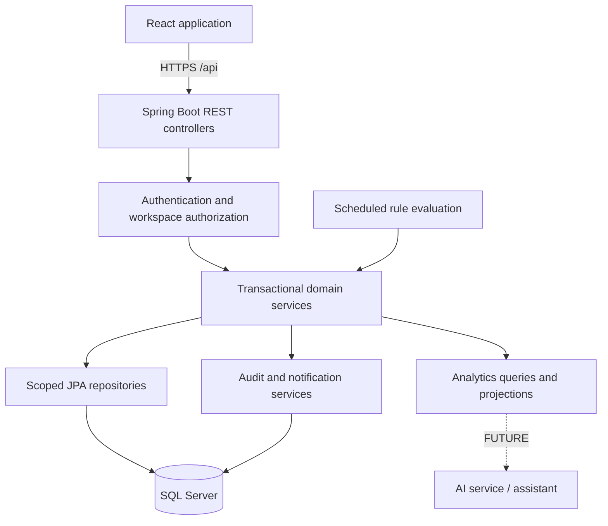
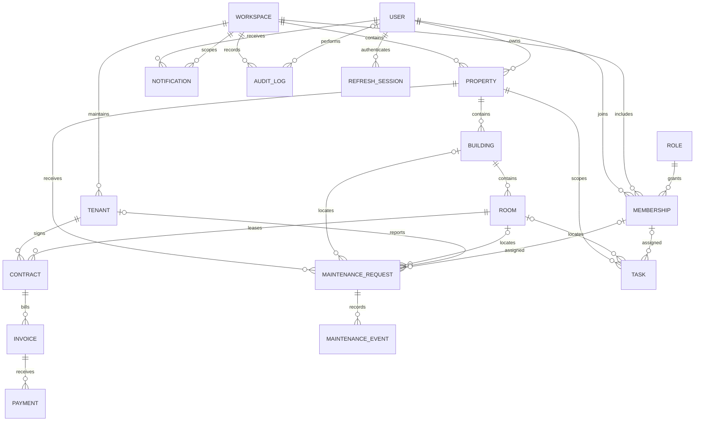

# HOLOKA — Step 1: System Architecture

Status: Architecture approved. SQL Server selected by the user. Steps 2–8 implemented; see the step reports for verified scope. Remaining sections describe the target architecture.

## 1. Scope and decisions

Phase 1 is a real, database-backed property operations application: authentication, portfolio management, leasing, billing, payments, maintenance, tasks, notifications, analytics, and deterministic operational alerts. Advanced AI, resident/provider portals, predictions, and external payment processing are FUTURE FEATURES.

Confirmed by the user: Microsoft SQL Server, administered through SSMS. Use the Microsoft JDBC driver and SQL Server-compatible migrations. This decision supersedes the original MySQL references in the brief.

Use Java 21, Spring Boot, Maven, Spring Web, Spring Data JPA, Spring Security, Bean Validation, Lombok, JWT, SQL Server, and OpenAPI. Use React, TypeScript, React Router, Axios, and Tailwind CSS. Select compatible maintained dependency versions during implementation and lock them in build files.

## 2. System architecture



Deploy initially as a modular monolith: one backend, one frontend, one database. Organize backend modules by business domain, with controller, DTO, service, and repository boundaries inside each module. Controllers validate transport input; services enforce permissions, relationships, state transitions, and transactions; repositories enforce scoped data access. Entities are never serialized directly to clients.

Serve frontend and API under one origin in production. Use a development proxy locally. Keep secrets in environment configuration and use TLS, restricted database credentials, health checks, migrations, backups, and structured logs for deployment. Production readiness must be verified rather than assumed from a successful build.

## 3. Database ERD

Additional Workspace and Membership entities provide an explicit isolation boundary for owners and their teams. Registering an owner creates a workspace and an OWNER membership. Tenant means a renter; it is distinct from workspace isolation.



Every operational entity has a workspace ID, directly or through a verified relationship. Prefer direct workspace columns on frequently queried records, with consistency checks and scoped foreign keys where practical. IDs never establish authorization by themselves.

### Entity responsibilities

| Entity | Main fields and constraints |
| --- | --- |
| User | ID, name, normalized unique email, password hash, enabled, timestamps; no password/hash in responses |
| Role / Membership | ADMIN, OWNER, MANAGER, STAFF; unique user/workspace membership; ADMIN is platform-scoped |
| Workspace | Name, currency VND, timezone Asia/Ho_Chi_Minh, operational thresholds |
| Property | Brief fields; owner must be an eligible member; code unique within workspace |
| Building | Brief fields; required property; code unique within property; positive floor count |
| Room | Brief fields; required building; property derived from building; code unique within building; nonnegative rent, positive area; availableSince |
| Tenant | Brief fields; scoped identity number and contact data; restrict sensitive fields by role |
| Contract | Brief fields; room and tenant required; date interval and monetary validations; version column |
| Invoice | Brief fields; contract required; room and tenant derived from contract; billingMonth stored consistently as first day of month; code unique within workspace |
| Payment | Brief fields; invoice required; positive decimal amount; unique idempotency key within workspace; posted/voided state |
| MaintenanceRequest | Brief fields; property required; optional consistent building/room/tenant; assigned membership; include ASSIGNED state |
| MaintenanceEvent | Request, actor, timestamp, previous/new status, note and cost changes; append-only history |
| Task | Brief fields; property required; optional room and assignee; completion timestamp controlled by service |
| Notification | Brief fields plus workspace, source type/ID and deduplication key; read state belongs to recipient |
| AuditLog | Actor, workspace, action, entity, entity ID, timestamp and safe description; immutable through ordinary APIs |
| RefreshSession | User, hashed token, expiration, revocation and rotation metadata |

Use DECIMAL for monetary values and Java BigDecimal for calculations. Store event timestamps in UTC and contractual/billing dates as dates. Apply workspace timezone when evaluating today or a month boundary. Preserve invoice financial snapshots even if contract pricing changes. Derived room/tenant/property relationships may be exposed in DTOs without duplicating them as independently editable foreign keys.

Use versioned migrations rather than automatic production schema updates. Index workspace/status, parent relationships, due dates, contract end dates, invoice billing month, payment date, notification recipient/read state, and audit timestamp. Paginate all major lists with capped page size, whitelisted sort fields, scoped search, and DTO projections/entity graphs to avoid N+1 queries.

## 4. Critical business rules

### Contracts and room occupancy

Treat rental periods as start-inclusive and end-exclusive: startDate < endDate. An ACTIVE contract blocks overlapping ACTIVE intervals. Lock the room row before checking overlaps and saving a contract so concurrent requests cannot both pass. Lock affected rooms consistently when moving a contract. Draft contracts do not occupy rooms.

Room occupancy reflects an ACTIVE contract covering today, including scheduled future ACTIVE contracts only when their start date arrives. Expiration and termination recalculate occupancy transactionally. A scheduled job updates date-driven statuses and availableSince. Reject manual room changes that contradict active occupancy; inactive or maintenance rooms cannot accept active leases without an explicit valid transition.

### Invoices and payments

Calculate totals exclusively on the backend from nonnegative charge components. Allow one standard invoice per contract/billing month; additional billing types require an explicit future extension. Resolve tenant, room, and property through the authorized contract.

Only DRAFT invoices have editable financial fields. Issue before collecting payments. Posted payment records are immutable; privileged void actions require a reason and audit entry. Lock the invoice before recording or voiding a payment. Reject zero, negative, and above-outstanding amounts. Idempotency keys prevent retries from recording the same payment twice.

PAID means balance is zero. PARTIALLY_PAID means payments exist and balance remains before the due date. OVERDUE means an issued invoice has an outstanding balance after its due date, including partially paid invoices. Expose paidAmount and outstandingAmount separately so the payment history remains clear. Cancel only invoices with no net posted payments. Payment method ONLINE records an externally received payment; gateway collection is a FUTURE FEATURE.

### Maintenance and tasks

Use OPEN → ASSIGNED → IN_PROGRESS → COMPLETED with explicit permitted WAITING/CANCELLED transitions. ASSIGNED resolves the brief's mismatch between its enum and workflow. Validate assigned users against active workspace membership and role. Append maintenance events for assignment, status and cost changes. Set completedAt server-side. Task states are TODO, IN_PROGRESS, COMPLETED, CANCELLED.

### Notifications and alerts

Generate deduplicated recipient-specific notifications for overdue invoices, urgent/high maintenance, overdue tasks, and approaching contract expiry. Run event-triggered evaluation after relevant writes and scheduled date-based evaluation. Rule keys identify source, recipient and alert window; repeated evaluation must not spam users.

Today's Action queries the same authorized operational records, split into urgent, needs attention, and upcoming items. Each item links to its record and an allowed action. Long vacancy uses availableSince and a workspace threshold. Exclude cancelled invoices, completed/cancelled work, and inactive leases from inappropriate alerts.

### Dashboard definitions

All values come from authorized database queries. Monthly revenue means posted cash receipts net of voids, grouped by payment date. Monthly expense means completed maintenance actual costs grouped by completion date; label this limitation because Phase 1 has no general expense ledger. Outstanding payments excludes drafts/cancelled invoices. Occupancy uses occupied divided by rentable rooms; inactive rooms are excluded and maintenance rooms are shown separately. Return zero safely for an empty denominator.

Include all requested property/building/room totals, occupancy counts/rate, active/expiring contracts, open maintenance, pending tasks, receipts and outstanding balances. Charts show monthly receipts, occupancy by property, maintenance state distribution, and paid versus outstanding for the same invoice cohort. Date and property filters must apply consistently to chart numerators and denominators.

## 5. API architecture

Prefix all endpoints with /api. Use request/response DTOs, Bean Validation, centralized exception handling, and grouped OpenAPI documentation.

```json
{"success":true,"message":"Success","data":{"items":[],"page":0,"size":20,"totalElements":0,"totalPages":0}}
```

```json
{"success":false,"message":"Room has an overlapping active contract","status":409,"timestamp":"2026-09-27T00:00:00Z"}
```

Errors may include safe field validation details and a request ID. Return 400 validation, 401 unauthenticated, 403 forbidden, 404 unavailable/out-of-scope records, 409 state conflict, and sanitized 500 responses. Security filter failures use the same envelope.

| Group | Endpoints |
| --- | --- |
| Authentication | POST /auth/register, /auth/login, /auth/refresh, /auth/logout; GET /auth/me; PUT /auth/change-password |
| Users | GET /users; POST /users for authorized team creation; PATCH /users/{id}/membership; PATCH /users/{id}/status |
| Profile/settings | PATCH /auth/me; GET/PATCH /settings |
| Properties/buildings/rooms/tenants | GET/POST /{resource}; GET/PUT/DELETE /{resource}/{id} |
| Contracts | GET/POST /contracts; GET/PUT /contracts/{id}; POST /contracts/{id}/activate or /terminate; DELETE draft only |
| Invoices | GET/POST /invoices; GET/PUT /invoices/{id}; POST /invoices/{id}/issue or /cancel; DELETE draft only |
| Payments | GET/POST /payments; GET /payments/{id}; POST /payments/{id}/void |
| Maintenance | GET/POST /maintenance; GET/PUT /maintenance/{id}; PATCH /maintenance/{id}/assignment or /status; GET /maintenance/{id}/history |
| Tasks | GET/POST /tasks; GET/PUT/DELETE /tasks/{id}; PATCH /tasks/{id}/assignment or /status |
| Notifications | GET /notifications; PATCH /notifications/{id}/read; POST /notifications/read-all |
| Dashboard | GET /dashboard/summary, /dashboard/revenue, /dashboard/occupancy, /dashboard/maintenance, /dashboard/payments |
| Action center | GET /actions with category/property filters |
| Audit | GET /audit-logs with privileged scoped access |

List endpoints accept page, size, sort, search and applicable status/propertyId/buildingId/tenantId/billingMonth filters. Detail responses provide related summaries; paginate long rental/payment/history collections separately. Reject deleting referenced financial or lease records; deactivate master records when history exists.

Access tokens are short-lived and held in frontend memory. Refresh tokens are random, hashed server-side, rotated, and sent through HttpOnly Secure cookies with appropriate SameSite policy. Protect cookie-authenticated endpoints against CSRF and validate allowed origins. Logout and password changes revoke sessions; password changes also invalidate outstanding access tokens through user token version/security checks. Rate-limit authentication and never accept a role from public registration.

## 6. Frontend architecture

```text
src/
  assets/
  components/     # buttons, inputs, dialog, table, badges, charts, feedback
  layouts/        # public authentication and responsive application shells
  pages/          # domain pages and details
  services/       # Axios client and typed resource APIs
  hooks/          # queries, pagination, filters, form helpers
  contexts/       # authentication and workspace context
  types/          # API DTOs and domain types
  utils/          # VND/date formatting and validation helpers
  routes/         # router and role-aware guards
  App.tsx
```

Routes: /login, /register, /dashboard, /properties, /properties/:id, /buildings, /buildings/:id, /rooms, /rooms/:id, /tenants, /tenants/:id, /contracts, /contracts/:id, /invoices, /invoices/:id, /payments, /maintenance, /maintenance/:id, /tasks, /notifications, /profile, /settings. Add team administration within settings for permitted users.

Use a restrained slate/teal SaaS interface with persistent desktop navigation, a compact top bar, and mobile navigation drawer. Dashboard leads with Today's Action, then operational metrics and charts. List screens provide URL-backed filters, search, sorting, pagination, and explicit detail/actions. Complex lease and invoice forms show a backend-validated summary before submission.

Every data screen has loading, empty, error and retry states. Forms expose inline validation and submission state; destructive actions require confirmation; successful operations show toasts and refresh affected queries. Dialogs support keyboard/focus management, tables have accessible headings, and status badges use text as well as color. Small screens use stacked cards or deliberate table overflow. UI guards improve usability; backend authorization remains authoritative.

Do not render invented metrics when the API is unavailable. Demo metrics come exclusively from seeded database records. AI assistant and prediction features remain clearly marked FUTURE FEATURE and are not presented as functional controls.

## 7. Folder structure

The existing HOLOKA-newconcept repository is the project root; no redundant nested holoka folder is necessary.

```text
backend/
  src/main/java/.../holoka/
    common/ config/ security/
    auth/ workspace/ user/
    property/ building/ room/ tenant/
    contract/ invoice/ payment/
    maintenance/ task/ notification/
    analytics/ audit/
  src/main/resources/
    application.properties
    db/migration/
  src/test/
  pom.xml
  README.md
frontend/
  src/
  package.json
  README.md
database/
  schema/          # ERD/schema documentation; executable migrations live in backend
  seed/            # documented development seed configuration
docs/
  architecture.md
  database.md
  api.md
.env.example
compose.yml
README.md
```

Seed a development-only workspace dataset with Vietnamese properties, buildings, rooms, renters, contracts, invoices, payments and operational work. Include the requested 1 admin, 2 owners, 3 managers, 5 staff, 5 properties, 10 buildings, 100 rooms and 50 tenants/contracts distributed across authorized workspaces. Seed explicitly and idempotently, using dates relative to the chosen seed date. Obtain demo passwords from configuration. Never auto-create demo accounts in production.

## 8. Roles and permissions

| Capability | ADMIN | OWNER | MANAGER | STAFF |
| --- | --- | --- | --- | --- |
| Platform accounts/workspace administration | Yes, audited | No | No | No |
| Operational workspace access | Explicit audited workspace scope | Own workspace | Assigned workspace | Assigned work scope |
| Property/building/room changes | In authorized scope | Full | Operational edits | Read needed records |
| Tenants/contracts | In authorized scope | Full | Create/manage | Minimum details needed for tasks |
| Invoices/payments | In authorized scope | Full | Issue/record | No finance access |
| Void payments | In authorized scope | Yes | No by default | No |
| Maintenance/tasks | In authorized scope | Full | Full/assign | Update assigned work |
| Team/role management | Platform administration | Own workspace | No | No |
| Notifications | Own notifications | Own notifications | Own notifications | Own notifications |
| Dashboard | Authorized scope | Workspace analytics | Workspace analytics | Assigned work summary |
| Settings | Platform settings | Workspace settings | Own profile | Own profile |

Public registration always creates an OWNER with a new workspace. Owners cannot grant ADMIN. Membership changes must prevent removing the last active owner. Financial and tenant identity information are restricted at DTO level as well as endpoint level. Cross-workspace foreign IDs, searches, aggregates, and notifications are tested for isolation.

## 9. Development roadmap and acceptance gates

| Step | Deliverable | Verification before proceeding |
| --- | --- | --- |
| 1 | This architecture, ERD, API/page plans and permission design | Review consistency; user confirmation required |
| 2 | Spring Boot skeleton, common DTO/error structure, configuration | Maven build, startup and health test |
| 3 | SQL Server, migrations, constraints and development database setup | Apply migrations to clean SQL Server; verify restart |
| 4 | Registration, login, refresh, profile, password changes, RBAC | Auth successes/failures, revocation, isolation tests |
| 5 | Property/building/room CRUD | CRUD, filters, references and authorization tests |
| 6 | Tenant/contracts and room lifecycle | Invalid dates, concurrent overlap, activation/expiry/termination tests |
| 7 | Invoices/payments | Totals, overdue, partial/full payment, duplicate retry and concurrency tests |
| 8 | Maintenance/tasks, assignment and history | Valid transitions, assignee authorization, completion/cost tests |
| 9 | Notifications and deterministic alerts | Time-controlled threshold and deduplication tests |
| 10 | Dashboard and action center projections | Compare calculations against controlled database fixtures |
| 11 | React shell, routes and reusable UI | Type checking, component behavior, accessible responsive shell |
| 12 | Connect every page and mutation to API | Browser owner journey using real persisted records |
| 13 | Integrated validation/security hardening | Cross-role/workspace denial, CSRF/CORS and error tests |
| 14 | Regression unit/integration/browser suite | Critical workflow suite passes against SQL Server |
| 15 | UI polish and responsive verification | Desktop/mobile checks, empty/loading/error/dialog behavior |
| 16 | Setup, API, demo, deployment and limitations documentation | Clean installation rehearsal |
| 17 | Production build and deployment configuration | Frontend/backend builds and production-config smoke test |

Use unit tests for pure calculations and rules, Spring integration tests with real SQL Server for transactions/constraints/security, and browser tests for the complete owner workflow. The current local suite uses a dedicated SQL Server test database; a Testcontainers CI option can be added when a container runtime is available. Security is built into each module from the start; Step 13 verifies the complete integrated boundary.

After each step, report changed files, key implementation choices/code references, run/test commands, check results, and unresolved issues. Do not claim unexecuted tests passed. Stop implementation progression when a required current-step verification is blocked or failing.

Final acceptance: an owner registers, signs in, creates a property/building/room and tenant, activates a contract, issues an invoice, records partial then full payment, raises maintenance, assigns work to an authorized team member, receives a generated notification, and sees consistent persisted dashboard/action-center results after refresh. A second workspace cannot read or mutate any of these records.

## Step 1 verification

- Covered architecture, ERD, relationships, API architecture, frontend structure, folders, roles, and roadmap.
- Resolved database tooling conflict: the user selected SQL Server with SSMS.
- Resolved planned maintenance ASSIGNED state and clarified date-based occupancy, overdue partial payments, and cash-basis reporting.
- At the Step 1 review, no implementation existed. Subsequent verified implementation is recorded separately in the step reports; this target architecture is not a claim that future functionality is complete.
- Architecture and SQL Server selection confirmed; Step 2 authorized.

